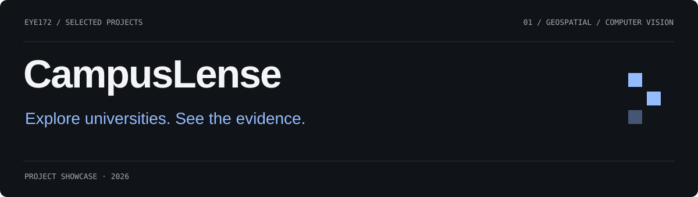
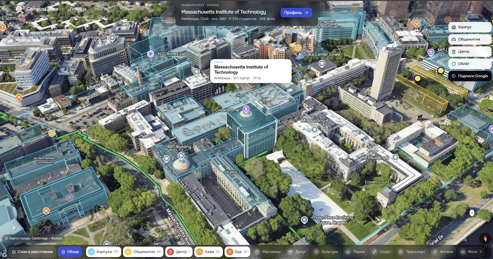
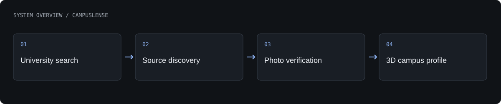

# CampusLense

A visual university discovery product that connects a globe, 3D campus exploration and source-backed university profiles.

**Hackathon prototype · LOCUS 2026 · first place**

[What is built](#what-is-built) · [Architecture](#architecture) · [Authors](#authors) · [Profile](https://github.com/Eye172)

## Product gallery

3D exploration of the MIT campus.

More screenshots and project visuals

Verification view with source and image checks.

University profile on a narrow screen.

## What is built

- Search a local index of 14,467 universities and supplement it with live discovery.
- Explore campus buildings, accommodation, facilities and the surrounding city in 3D.
- Browse photographs with provenance, relevance checks and rejection explanations.
- Stream profile results as sources are processed; save and compare universities.

## Architecture

A browser interface combines a searchable university catalogue with campus maps. A Python API discovers source material, processes and deduplicates photographs, evaluates relevance and streams progress to the interface. Source information stays attached to the resulting media.

**Technology:** React · TypeScript · Vite · MapLibre · Google Maps 3D · Python · FastAPI · SQLite · CLIP.

## Current scope

The documented internal photo benchmark used 223 manually labelled images and reported 0.94 precision and recall. Results on this sample are not a guarantee for every university or image source.

## Authors

**QwertyS** — [Shakhnazar Akhmer](https://github.com/Eye172) and [Nurkhan Aimukatov](https://github.com/pip00sya).

## About this repository

This is a standalone project showcase containing a product description, visuals and a high-level architecture overview. Implementation source, model weights, credentials and internal project materials are not distributed here. No deployment is required to explore this page.

[Contact](mailto:shakh090909@gmail.com) · [GitHub profile](https://github.com/Eye172)
